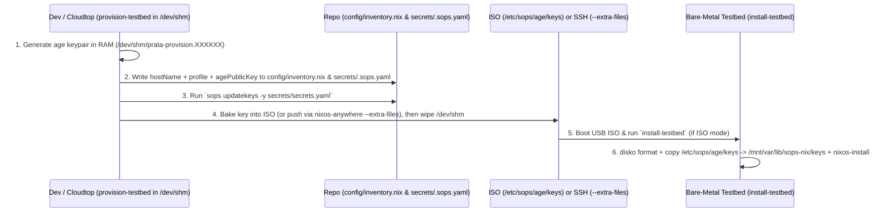

# Requirement: Declarative Testbed Inventory, Secret Key Provisioning & 1-Step Installer

**Date:** 2026-10-21
**Topic:** `testbed-secrets-provisioning`
**Status:** Approved

## 1. Problem Statement

Provisioning NixOS testbed machines currently suffers from four operational bottlenecks:

1. **Chicken-and-Egg Secret Bootstrap:** [`modules/core/sops.nix`](file:///usr/local/google/home/tanyuanzheng/code/nixos-b850-5090/modules/core/sops.nix) derives the `sops-nix` decryption key from the target's post-install `/etc/ssh/ssh_host_ed25519_key`. Operators must install without secrets, boot the machine, extract the SSH key, update [`.sops.yaml`](file:///usr/local/google/home/tanyuanzheng/code/nixos-b850-5090/.sops.yaml), re-encrypt `secrets/secrets.yaml`, and run a second rebuild.
2. **Single-Host & Single-Profile Hardcoding:** [`modules/core/network.nix`](file:///usr/local/google/home/tanyuanzheng/code/nixos-b850-5090/modules/core/network.nix) hardcodes `networking.hostName = "grod-rtx5090"`, and [`flake.nix`](file:///usr/local/google/home/tanyuanzheng/code/nixos-b850-5090/flake.nix) hardcodes `home-manager.users.tanyuanzheng` inside a single `workstation` output with no declarative inventory or separation between `prod` (`prata-admin` + `prata` only, no Home Manager) and `dev` beds (team accounts managed with Home Manager).
3. **Manual Disk Partitioning & Missing Swap:** [`README.md`](file:///usr/local/google/home/tanyuanzheng/code/nixos-b850-5090/README.md) requires manual `parted`, `mkfs`, and `mount` commands on every install, and [`hosts/workstation/hardware-configuration.nix`](file:///usr/local/google/home/tanyuanzheng/code/nixos-b850-5090/hosts/workstation/hardware-configuration.nix) sets `swapDevices = [ ];`.
4. **No Automated Provisioning Pipeline:** There is no cloudtop/dev utility that mints a new testbed's `age` key in memory, updates the inventory and SOPS recipients, and produces a ready-to-install ISO (or remote install) with that testbed's private key pre-baked without leaving private keys on the dev machine's disk.

## 2. Goals & Success Criteria

1. **Declarative Testbed Inventory (`config/inventory.nix`) & Prod/Dev Profiles (`prata.profile`):**
   - Pure testbed inventory under `config/inventory.nix` where each entry defines a testbed's `hostName`, `profile` (`"prod"` or `"dev"`, default `"prod"`), `diskDevice`, optional `swap` overrides, and `agePublicKey`.
   - Default OS hostname set to `lib.mkDefault "prata-host"` in [`modules/core/network.nix`](file:///usr/local/google/home/tanyuanzheng/code/nixos-b850-5090/modules/core/network.nix).
   - `prod` beds create only `prata-admin` (privileged: `wheel`, `networkmanager`, `docker`, `video`) and `prata` (unprivileged: `networkmanager`, `docker`, `video`) with no Home Manager; `dev` beds additionally create `prata.devUsers` (`tanyuanzheng`, `jiehao`, `zhin`, `danielkun`) wired to Home Manager (`home/default.nix`) inside [`modules/core/users.nix`](file:///usr/local/google/home/tanyuanzheng/code/nixos-b850-5090/modules/core/users.nix) (`mkTestbed` in `flake.nix` must not hardcode `home-manager.users.tanyuanzheng`).
   - Move `fd` and add `zoxide` to system-wide [`modules/core/packages.nix`](file:///usr/local/google/home/tanyuanzheng/code/nixos-b850-5090/modules/core/packages.nix) (`fd` removed from [`home/default.nix`](file:///usr/local/google/home/tanyuanzheng/code/nixos-b850-5090/home/default.nix)).
   - [`flake.nix`](file:///usr/local/google/home/tanyuanzheng/code/nixos-b850-5090/flake.nix) generates `nixosConfigurations.<hostName>` for every entry in `config/inventory.nix` from the shared Golden OS profile (`./hosts/workstation`).
2. **Clean Separation Between Dev/Cloud Provisioner (`provision-testbed`) and Target Installer (`install-testbed`) with Ephemeral Private Key Handling:**
   - **Dev / Cloudtop / CI Utility (`nix run .#provision -- <hostName> [--profile prod|dev]`):**
     1. Generates a unique `age` keypair (`age-keygen`) for `<hostName>` strictly in ephemeral memory (`/dev/shm`), never persisting the private key to the dev machine's disk.
     2. Updates `config/inventory.nix` and `secrets/.sops.yaml` (moved from root `.sops.yaml` into `secrets/.sops.yaml`) with `<hostName>`'s `agePublicKey`, and runs `sops updatekeys -y secrets/secrets.yaml`.
     3. Either builds the installer ISO with the in-memory `age` private key baked into `/etc/sops/age/keys` (`0400`) and optionally flashes it to USB (`--flash <device>`), OR deploys directly over SSH via `nixos-anywhere --extra-files` (`--target root@<ip>`) directly from the `/dev/shm` staging directory, wiping `/dev/shm` upon exit.
   - **Target Bare-Metal Utility (`install-testbed`, shipped inside the ISO):**
     1. Runs on the bare-metal testbed booted from the USB ISO.
     2. Formats and mounts the NVMe disk via `disko`.
     3. Copies `/etc/sops/age/keys` from the ISO to `/mnt/var/lib/sops-nix/keys` (`0400 root:root`).
     4. Runs `nixos-install --flake ...#<hostName> --no-root-passwd`.
     5. Boot #1 immediately decrypts `secrets/secrets.yaml` using `/var/lib/sops-nix/keys` with zero post-boot steps.
3. **Declarative Disk Layout (`disko`) + Configurable Dynamic Swap:**
   - Integrate `github:nix-community/disko` to partition `diskDevice` (default `/dev/nvme0n1`) with a `1024MiB` `vfat` ESP (`/boot`, label `boot`) and `100%` remaining `ext4` root (`/`, label `nixos`).
   - Provision and activate `/var/swapfile` on the root filesystem sized dynamically to $\min(\lfloor \text{diskPercent} \times \text{disk\_bytes} \rfloor, \text{maxSizeGiB})$, with configurable NixOS options defaulting to `diskPercent = 20` and `maxSizeGiB = 128`.

## 3. Non-Goals

- Implementing the external KMS server backend itself (each testbed's unique `/var/lib/sops-nix/keys` will later authenticate or decrypt the KMS bootstrap credential).
- Defining arm/camera calibration schemas inside `config/inventory.nix` (deferred to the `prata.testbed` schema change).

## 4. Technical Design

### 4.1 Repository Layout Changes

```
.gitignore                        # New: ignores .worktree/, result*
flake.nix                         # Updated: adds disko input, reads config/inventory.nix, exposes .#provision
config/
  inventory.nix                   # New: declarative testbed inventory (default host: prata-host)
secrets/
  .sops.yaml                      # Moved from /.sops.yaml: admin age key + host age keys from inventory
  secrets.example.yaml            # Existing template
home/
  default.nix                     # Updated: removes fd (moved to system-wide packages.nix)
hosts/workstation/
  default.nix                     # Existing entry point
  hardware-configuration.nix      # Updated: delegates / and /boot filesystems to disko
modules/core/
  disko.nix                       # New: disko GPT layout (1024MiB ESP + 100% ext4 root)
  swap.nix                        # New: configurable prata.swap.{enable,diskPercent,maxSizeGiB} module
  users.nix                       # Updated: prata.profile ("prod" | "dev"), prata-admin + prata base accounts, devUsers + Home Manager in dev
  packages.nix                    # Updated: adds fd and zoxide system-wide
  network.nix                     # Updated: networking.hostName = lib.mkDefault "prata-host"
  sops.nix                        # Updated: sops.age.keyFile = "/var/lib/sops-nix/keys"
  provision.nix                   # New: provision-testbed (dev/cloud CLI) derivation
modules/installer/
  iso.nix                         # Updated: embeds target age key at /etc/sops/age/keys & ships install-testbed
```

### 4.2 Declarative Inventory (`config/inventory.nix`) & Prod/Dev Profiles (`modules/core/users.nix`)

Each entry in `config/inventory.nix` defines a testbed, its `hostName`, and its `profile` (`"prod"` or `"dev"`):

```nix
{
  prata-host = {
    hostName = "prata-host";
    profile = "prod";
    diskDevice = "/dev/nvme0n1";
    agePublicKey = null; # Populated automatically by `nix run .#provision -- prata-host`
    swap = {
      enable = true;
      diskPercent = 20;
      maxSizeGiB = 128;
    };
  };
}
```

In [`flake.nix`](file:///usr/local/google/home/tanyuanzheng/code/nixos-b850-5090/flake.nix):
- `inventory = import ./config/inventory.nix;`
- `mkTestbed` maps each entry into `nixosConfigurations.${entry.hostName}` passing `networking.hostName = hostCfg.hostName;`, `prata.profile = hostCfg.profile or "prod";`, `prata.diskDevice = hostCfg.diskDevice or "/dev/nvme0n1";`, and `prata.swap = hostCfg.swap or { };` (with `nixosConfigurations.workstation` aliased to `nixosConfigurations.prata-host`).
- `mkTestbed` does **not** hardcode `home-manager.users.tanyuanzheng`; [`modules/core/users.nix`](file:///usr/local/google/home/tanyuanzheng/code/nixos-b850-5090/modules/core/users.nix) manages user accounts and wires `home-manager.users` only when `prata.profile == "dev"`.

### 4.3 Configurable Dynamic Swap (`modules/core/swap.nix`)

Defines NixOS options under `prata.swap`:
- `prata.swap.enable` (`bool`, default `true`)
- `prata.swap.diskPercent` (`ints.between 1 90`, default `20`)
- `prata.swap.maxSizeGiB` (`ints.positive`, default `128`)

When `prata.swap.enable = true`, systemd service `prata-swapfile.service` (`before = [ "swap.target" ]`, `wantedBy = [ "multi-user.target" ]`) runs at boot:
1. If `/var/swapfile` does not exist:
   - Queries total byte size of the root block device (`findmnt -n -o SOURCE /` -> `lsblk -b -d -n -o SIZE`).
   - Computes $\text{swap\_bytes} = \min(\lfloor \text{disk\_bytes} \times \text{diskPercent} / 100 \rfloor, \text{maxSizeGiB} \times 1024^3)$, converted to whole MiB.
   - Allocates `/var/swapfile` via `fallocate -l "${swap_mib}M" /var/swapfile`, sets `chmod 0600 /var/swapfile`, and runs `mkswap /var/swapfile`.
2. Activates `/var/swapfile` via `swapon /var/swapfile` if not already active in `/proc/swaps`.

### 4.4 Per-Testbed Age Key & `sops-nix` Configuration

1. **`secrets/.sops.yaml`:**
   - Moving `.sops.yaml` into `secrets/.sops.yaml` keeps all SOPS configuration inside `secrets/`. Because the `sops` CLI walks upward from the target file (`secrets/secrets.yaml`), `sops secrets/secrets.yaml` and `sops updatekeys secrets/secrets.yaml` automatically discover `secrets/.sops.yaml` (`path_regex: ^secrets\.yaml$`).
2. **Target Decryption ([`modules/core/sops.nix`](file:///usr/local/google/home/tanyuanzheng/code/nixos-b850-5090/modules/core/sops.nix)):**
   - Sets `sops.age.keyFile = "/var/lib/sops-nix/keys";` (removing `ssh-to-age` and `/etc/ssh/ssh_host_ed25519_key` coupling).

### 4.5 Two-Stage Workflow: Ephemeral Dev Provisioner vs. Target Installer



1. **Dev / Cloudtop Utility (`provision-testbed` via `nix run .#provision`):**
   - Usage: `nix run .#provision -- <hostName> [--profile prod|dev] [--disk /dev/nvme0n1] [--flash /dev/sdX | --target root@<ip>]`
   - Step 1: Creates an ephemeral directory in RAM (`mktemp -d /dev/shm/prata-provision.XXXXXX` with `trap 'rm -rf "$SHM_DIR"' EXIT`) and runs `age-keygen` into `$SHM_DIR/var/lib/sops-nix/keys` (`0400`), extracting the `age1...` public key in memory.
   - Step 2: Updates `config/inventory.nix` with `<hostName>`, `profile`, and its new `agePublicKey`.
   - Step 3: Regenerates host recipients in `secrets/.sops.yaml` (preserving admin keys) and runs `sops updatekeys -y secrets/secrets.yaml` (if `secrets/secrets.yaml` exists).
   - Step 4:
     - **Default / `--flash <dev>` (ISO mode):** Builds `.#iso` using `--impure` with `PRATA_ISO_AGE_KEY_FILE="$SHM_DIR/var/lib/sops-nix/keys"` and `PRATA_ISO_TARGET_HOST="<hostName>"` so the ISO embeds `/etc/sops/age/keys` (`0400`) and defaults `install-testbed` to `<hostName>`. If `--flash <dev>` is specified, writes the ISO to the USB device via `dd`.
     - **`--target <user@ip>` (Remote SSH mode):** Runs `nixos-anywhere --extra-files "$SHM_DIR" --flake ".#<hostName>" "$target"` to partition the remote disk via `disko` and place `/var/lib/sops-nix/keys` (`0400`) directly onto the target filesystem.
   - Step 5: `EXIT` trap shreds and removes `$SHM_DIR` from RAM—no private key remains on the dev machine.
2. **Target Bare-Metal Utility (`install-testbed` inside `modules/installer/iso.nix`):**
   - Usage on live USB console: `sudo install-testbed [<hostName>]` (defaults to the `<hostName>` baked into the ISO, or `prata-host`).
   - Step 1: Runs `disko --mode destroy,format,mount` for `<hostName>`.
   - Step 2: Installs `/etc/sops/age/keys` (if present on ISO) to `/mnt/var/lib/sops-nix/keys` (`0400 root:root`).
   - Step 3: Runs `nixos-install --flake "<iso-flake>#<hostName>" --no-root-passwd`.

## 5. Verification Plan

1. `nix flake check` passes with zero errors.
2. `nix eval .#nixosConfigurations.prata-host.config.networking.hostName` returns `"prata-host"`.
3. `nix eval .#nixosConfigurations.prata-host.config.sops.age.keyFile` returns `"/var/lib/sops-nix/keys"`.
4. `nix eval .#nixosConfigurations.prata-host.config.prata.profile` returns `"prod"`, with only `prata-admin` and `prata` users and empty `home-manager.users`.
5. `nix eval .#nixosConfigurations.prata-host.config.prata.swap` returns `{ diskPercent = 20; enable = true; maxSizeGiB = 128; }`.
6. Test `provision-testbed --dry-run` key generation in `/dev/shm`, `config/inventory.nix` update, `secrets/.sops.yaml` sync, and verify zero private key files remain after exit.
7. Test swap size calculation logic across simulated disk sizes (`500 GiB` -> `100 GiB`, `1000 GiB` -> `128 GiB`).
